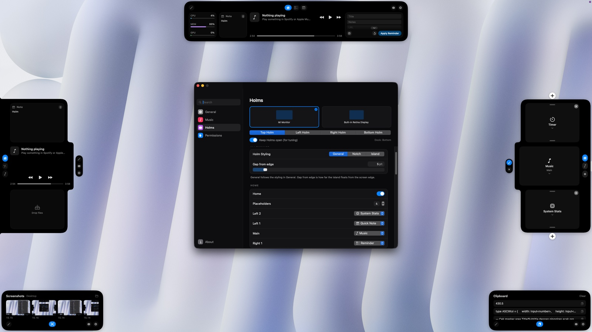
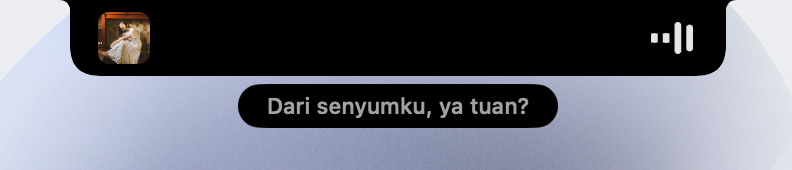

# Emper Notch

A free, open-source (GPL-3.0) dynamic island for the edges of your Mac screen. One small "Emper" per screen edge
(top, left, right, bottom) and per display. It expands on hover into a set of tabs.

Emper started as a tool for my own Mac. Synced lyrics, a screenshot shelf and an island on every screen edge are just a few of the things I wanted. It's shaped by what I use every day, so it won't cover every use case. Ideas and issues are welcome.

Status: **early prototype (v0.1.3)**. Expect rough edges.




## Features

Emper is a young project. Each feature is marked with how well it has been tested.

| Area | v0.1.3 |
|---|---|
| Hover / un-hover open and close, edge placement | Tested |
| Multiple displays (one Emper set per display) | Tested |
| **Music**: now playing (Spotify, Apple Music, other system media), controls, seek, optional synced lyrics | Tested, **included** |
| **Quick Note**: one plain-text scratch note, saved locally | Tested, **included** |
| **Screenshots** shelf | Tested, **included** |
| **Home**: main and side placeholders (holds the features above) | Included |
| **Bluetooth toast**: a short notice when a device connects, with battery when macOS reports it (off by default) | **Included** (experimental) |
| **Full screen**: the Emper shrinks to a thin line with no idle activity; push the cursor against the edge to open it | Included, not yet tested by hand |
| **Hide in Mission Control** (no permission needed; checked once a second) | Included |
| **Shrink** button (beside the pencil): keep an Emper as the thin full-screen line until you push the cursor against the edge, for apps macOS doesn't report as full screen | Included, not yet tested by hand |
| Reminder, Timer, Calculator, Clipboard history, File shelf, System stats | In the code, **hidden in v0.1.3** (experimental) |

**Synced lyrics** (optional, Settings › Music): the current line follows the song under the open Emper, and inside
the idle Emper.




The hidden features are not removed. Developers can switch them on with
`defaults write com.skrubbb.emper showExperimental -bool true` (then restart Emper) or by launching with `--experimental`.
Layout on notched MacBooks and Bottom Emper beside a visible Dock are also still experimental.

*Tested* means it was used by hand on a real Mac during development. It does not mean bug-free.
*Experimental* means it works in our checks but has had little real-world use. Expect rough edges.

## Build and run

Requires macOS 14+ and Swift 5.10+ (Xcode Command Line Tools are enough).

```bash
./scripts/run.sh            # build Emper.app and launch it
./scripts/build-app.sh      # build only -> build/Emper.app
swift test                  # unit tests (EmperCore)
build/Emper.app/Contents/MacOS/Emper --selftest   # drives real panels, prints PASS/FAIL
```

Emper lives in the menu bar: **Emper Settings…** / **Quit Emper**.

## Installing a build (not notarized)

Builds are ad-hoc signed and **not notarized** (no paid Apple Developer account), so macOS Gatekeeper blocks the
first launch. To open a downloaded build:

1. Move `Emper.app` to `/Applications`.
2. Try to open it once, then go to **System Settings → Privacy & Security** and click **Open Anyway**.
   Or right-click the app → **Open**.
3. Or, in Terminal: `xattr -dr com.apple.quarantine /Applications/Emper.app`

Exact wording differs between macOS versions. Because Emper is open source, you can also read the code and build it
yourself (see above).

## Updates

Emper uses [Sparkle](https://sparkle-project.org) (MIT). At launch and once a day it reads a small update list
(`appcast.xml`) from this repo's GitHub releases. When a newer version exists, a red dot appears on the menu bar
icon and on **About** in Settings. Nothing downloads or installs until you click **Install Update…**; Sparkle then
downloads the update, verifies its EdDSA signature against the public key built into Emper, and relaunches.

Emper opens at login by default (**Settings → General → Launch at login** turns it off).

**Settings → General → Reset** restores all settings to defaults (after two confirmations). The previous
settings file is kept as a backup; your Quick Note and screenshots are not touched.

## Privacy and network

- No telemetry, no accounts, no analytics.
- Settings and the Quick Note are stored locally in `~/Library/Application Support/Emper/`, readable only by your account.
- The only network requests: album artwork URLs reported by Spotify (HTTPS only); the update list
  (`appcast.xml` on github.com) at launch and once a day, plus the update download when you click Install; and, **only if you turn on lyrics**, a lookup at [lrclib.net](https://lrclib.net) with the
  track title, artist, album and duration.
- A fresh install asks for no permission at launch. Each one is asked only after you tap its Allow button or
  turn its toggle on:
  - **Files** (Desktop): the **Allow Access** button in the Screenshots tab.
  - **Automation** (Spotify / Apple Music): off by default, because music is followed through macOS's Now
    Playing with no permission. The Music tab shows **Allow Spotify & Apple Music control** only when that is
    not enough; the same choice is the **Players** menu in Settings › Music.
  - **Bluetooth**: the Bluetooth toast is off by default; macOS asks when you turn it on.
  - Emper needs no Accessibility permission. The hidden experimental features may additionally ask for Reminders.

## Roadmap

- **Windows (future)**: a Windows version is planned, but the implementation language is not decided yet.
  Nothing has been started. Options are being evaluated.
- Move more features from Experimental to Tested.
- Fewer private APIs for system-wide Now Playing, if Apple opens a public one.

Bug reports are welcome in Issues. Pull requests are not being accepted yet while the early foundation is
still changing; feel free to open an issue to discuss an idea first.

## Known limitation: private MediaRemote API

System-wide "now playing" uses Apple's private MediaRemote framework through a small helper
(`Helpers/MediaRemoteBridge.m`) loaded by `/usr/bin/perl`, because macOS 15.4+ restricts direct access. This is
not a public API and may stop working in a future macOS update.

## Code layout

```
Sources/EmperCore/   pure logic, no AppKit, unit-tested
Sources/Emper/
  App/        entry point, AppDelegate, ConfigStore (JSON), SelfTest
  Island/     IslandManager, IslandController, panels, shapes, views, controls
  Services/   NowPlaying, SystemMedia, ClipboardHistory, TextOverlay, shelves, timers
  Modules/    one folder per feature
  Settings/   SettingsView
Helpers/      MediaRemote bridge (Objective-C)
```

## Note on development

Emper is built with heavy AI assistance. Features marked **Tested** were verified by hand on a real Mac, and the
core logic has unit tests (`swift test`). The code may still contain rough edges or unconventional patterns.
Because Emper asks for system permissions and uses a private API, the full source is open under GPL-3.0 so anyone
can read, audit, or improve it.

## Support Emper

Emper is free and stays free. If it made your Mac a little nicer, you can buy me a coffee:
[Ko-fi](https://ko-fi.com/skrubbb) · [Saweria](https://saweria.co/skrubbb) (Indonesia)
